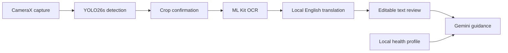

# NutritionScanner

**Lightweight nutrition-label detection, multilingual OCR, and mobile dietary guidance.**

NutritionScanner combines computer vision with an Android workflow for scanning
nutrition labels, reviewing extracted text, and receiving personalised
informational guidance. The research develops a compressed MobileNetV2-SSD
detector for resource-constrained devices and compares it with YOLO26s INT8,
the detector used in the Android demonstration.

## Research results

Both detectors are evaluated on the same single-class nutrition-label dataset:
**6,363 training images**, **528 validation images**, and **387 held-out test
images**. The YOLO test evaluation contains **391 annotated label instances**.
The primary metric is **mAP@0.50:0.95**, with AP50, precision, recall, and F1
describing detection performance.

### MobileNetV2-SSD compression pipeline

The pipeline progresses from a full-width teacher through knowledge
distillation, structured pruning, and quantization-aware training (QAT).

| Model | mAP@0.50:0.95 | AP50 | Precision | Recall | F1 |
| --- | ---: | ---: | ---: | ---: | ---: |
| Teacher | 0.6929 | 0.9563 | 0.9712 | 0.9488 | 0.9599 |
| KD student | 0.6567 | 0.9598 | 0.9734 | 0.9361 | 0.9544 |
| Pruned student | 0.5806 | 0.9522 | 0.9364 | 0.9412 | 0.9388 |
| **QAT TFLite** | **0.5952** | **0.9545** | **0.9462** | **0.9437** | **0.9449** |

Knowledge distillation reduces the model from **3,706,928 teacher parameters**
to **717,168 student parameters**. Structured pruning reduces it further to
**638,752 parameters**, an **82.8% reduction from the teacher**. The final INT8
TFLite artifact occupies **0.89 MB**, with recorded CPU inference time of
**6.09 ms**. QAT improves strict-IoU localisation from **0.5806** to **0.5952**
while retaining AP50 of **0.9545**.

### YOLO26s INT8 benchmark

| Precision | Recall | AP50 | mAP@0.50:0.95 |
| ---: | ---: | ---: | ---: |
| **0.9350** | **0.9540** | **0.9606** | **0.7445** |

YOLO26s provides stronger localisation across the stricter IoU thresholds.
Its **10.20 MB** INT8 TFLite model powers the Android demonstration. The
compressed MobileNetV2-SSD model provides a **0.89 MB** deployment option for
devices with tighter storage and compute budgets.

| Property | MobileNetV2-SSD QAT | YOLO26s INT8 |
| --- | ---: | ---: |
| Input resolution | 256 x 256 | 640 x 640 |
| mAP@0.50:0.95 | 0.5952 | 0.7445 |
| AP50 | 0.9545 | 0.9606 |
| Model artifact size | 0.89 MB | 10.20 MB |
| Deployment role | Resource-constrained targets | Android demonstration |

## Training methodology

The MobileNetV2-SSD research model uses a **256 x 256** input and an
ImageNet-pretrained MobileNetV2 backbone. The teacher has width multiplier
**1.0** and a **256-channel FPN**; the student has width multiplier **0.35**
and a **96-channel FPN**. Five detection feature maps provide **2,728 anchors**.

1. **Teacher training:** 320 epochs establish the full-width detector.
2. **Knowledge distillation:** 194 epochs train the smaller student using SSD
   supervision, temperature-scaled logit matching, and intermediate features.
3. **Structured pruning:** L1-norm channel pruning targets expansion channels
   at a ratio of 0.30, followed by 60 fine-tuning epochs.
4. **Quantization-aware training:** 40 epochs prepare the pruned model for
   INT8 TFLite export.

The YOLO26s run uses **Ultralytics 8.4.98**, two **Tesla T4 GPUs**, batch size
**64**, and cosine learning-rate scheduling. Training records **127 epochs**
against a 200-epoch ceiling. Validation selects the models; held-out testing
provides the results above.

## Android demonstration

The Android demonstration is in **`NutritionScannerV5Demo/`**.
It is built with **Kotlin**, **Jetpack Compose**, **CameraX**, **TensorFlow Lite**,
and **Google ML Kit**.



- **Live framing and photo detection:** a live overlay assists capture; the
  detector runs again on the captured photograph before proposing the crop.
- **Manual crop adjustment:** the user confirms or adjusts the label region
  before text extraction.
- **Multilingual text extraction:** bundled recognizers support Latin,
  Devanagari, Chinese, Japanese, and Korean scripts. Supported non-English
  text is translated to English on-device.
- **Reviewed guidance:** editable label text and dietary preferences,
  allergies, and selected health flags provide context for Gemini.

Detection, cropping, OCR, and translation run on the phone. Gemini receives
reviewed text and profile context; the photograph stays on-device. Profiles
use Android DataStore. Translation models may download on first use, and
Gemini guidance requires an internet connection and a configured API key.

## Repository layout

| Path | Contents |
| --- | --- |
| `NutritionScannerV5Demo/` | YOLO26s Android demonstration with its bundled TFLite model |
| `app/` | Additional Android application using the 128 x 128 v5 MobileNetV2-SSD detector |
| `nutrition_detector_model_128_07mb_v5/code/` | Retained v5 MobileNet training, distillation, pruning, QAT, and evaluation code |
| `nutrition_detector_model_128_07mb_v5/nutrition_detector_run_128_07mb/` | v5 checkpoints, exported detector, and evaluation artifacts |
| `yolo26_training_results2/` | YOLO training configurations, results, curves, and confusion matrices |
| `RUN_PROJECT.md` | Detailed setup and execution instructions for both Android projects |

The results above use the **256 x 256 MobileNetV2-SSD research configuration**
and the **640 x 640 YOLO26s configuration**.
The repository also retains the **128 x 128 v5 implementation** as a separate
MobileNet deployment package. Both Android applications include their runtime
models and can be built directly.

## Run locally

Install **JDK 17**, **Android SDK Platform 36**, and Android Studio. Use an
Android **8.0+ (API 26+)** device with a camera.

Open `NutritionScannerV5Demo/` as an Android Studio project, select the `app`
configuration, and run it on the connected device. To build from the repository
root:

```powershell
# Windows PowerShell
Set-Location .\NutritionScannerV5Demo
.\gradlew.bat :app:assembleDebug
```

```bash
# macOS or Linux
cd NutritionScannerV5Demo
./gradlew :app:assembleDebug
```

For Gemini guidance, add `GEMINI_API_KEY` to this project's ignored
`local.properties`, using `local.properties.example` as the template. Preserve
any existing `sdk.dir` entry. Detection and OCR run without a Gemini key.
Keep real keys and APKs containing personal keys private.

To run the additional MobileNet app, open the repository root in Android
Studio or execute the build command there. The two applications share an
application ID, so installing one replaces the other on the same device.
See [RUN_PROJECT.md](RUN_PROJECT.md) for the complete instructions.

## Build checks

Run from either Android project's directory:

```powershell
.\gradlew.bat :app:assembleDebug :app:testDebugUnitTest :app:lintDebug
```

Both projects pass debug assembly and lint. The YOLO demo's **nine unit tests**
cover output-coordinate handling and Gemini response/request parsing.

## License

Project-authored source code is licensed under **AGPL-3.0-only**; see
[LICENSE](LICENSE). Third-party libraries, datasets, and model artifacts retain
their applicable terms. Attribution is in
[THIRD_PARTY_NOTICES.md](THIRD_PARTY_NOTICES.md).
